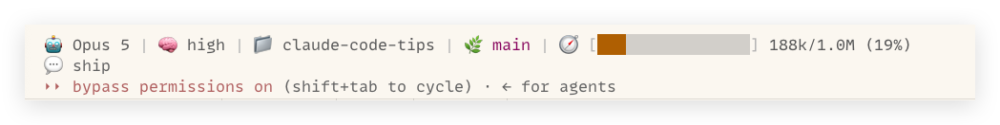

# Claude Code Scripts

## context-bar.sh

A two-line status line script for Claude Code that shows model, thinking effort, directory, git branch with uncommitted line changes, context usage, and your last message.

**Example output:**
```
🤖 Opus 5 | 🧠 high | 📁 claude-code-tips | 🌿 main(+12,-3) | 🧭 [████░░░░░░░░░░░░] 45k/200k (23%)
💬 This is good. I don't think we need to change the documentation as long as we don't say that the default color is orange el...
```

Each segment is labeled with an emoji. If your terminal font renders emoji
poorly, swap them for text labels with the `E_MODEL` … `E_CONTEXT` variables at
the top of the script (e.g. `E_MODEL="Model:"`).

The branch segment shows uncommitted line changes and, after them, a `?` count
of untracked files - `main(+12,-3,?2)`. `git diff` never reports untracked
paths, so without that count a tree whose only work is new files would look
clean. Ignored files are not counted.

### Installation

1. Copy the script to your Claude scripts directory:
   ```bash
   mkdir -p ~/.claude/scripts
   cp context-bar.sh ~/.claude/scripts/
   chmod +x ~/.claude/scripts/context-bar.sh
   ```

2. Update your `~/.claude/settings.json`:
   ```json
   {
     "statusLine": {
       "type": "command",
       "command": "~/.claude/scripts/context-bar.sh"
     }
   }
   ```

That's it!

### Color Themes

The script supports optional color themes for the labels and progress bar. Edit the `COLOR` variable at the top of the script:

```bash
# Color theme: gray, orange, blue, teal, green, lavender, rose, gold, slate, cyan, modus
COLOR="orange"
```

**The script ships with `COLOR="modus"`, which is built for a light terminal.**
On a dark background the text will be close to unreadable, so change `COLOR`
before you install it - any of the other ten themes assume a dark terminal.

The first ten themes are 256-color. `modus` is a 24-bit theme built from the
[modus-operandi-tinted](https://protesilaos.com/emacs/modus-themes) palette,
and it colors the context bar by usage: orange below 60%, `red-warmer` past
60%, `red-intense` past 85%.

Here is the `modus` theme running in a light terminal:



### Tests

```bash
bash scripts/test-context-bar.sh
```

The suite builds scratch git repos and mock transcripts, then checks what the
script renders: the git counts (clean, edits, untracked, ignored), the model and
thinking segments, token formatting, bar fill and threshold colors, and the
second line.

### Requirements

- `jq` (for JSON parsing)
- `bash`
- `git` (optional, for branch display)
- Claude Code 2.0.65+ (verified to work; older versions may not have the required JSON fields - check earlier commits for older versions)

### How it works

Claude Code passes session metadata to status line commands via stdin as JSON, including:
- `model.display_name` - The model name (the `(1M context)` suffix is stripped)
- `effort.level` - Thinking effort (low, medium, high), on models that support it
- `thinking.enabled` - Fallback for models without an effort level
- `cwd` - Current working directory
- `context_window.context_window_size` - Maximum context window size
- `transcript_path` - Path to the session transcript JSONL file

Context usage comes from the last `message.usage` entry in the transcript
(input + cache read + cache creation tokens), which is more accurate than the
token totals in the JSON because those leave out the system prompt, tools, and
memory. Before the first response lands, the script shows a `~20k` baseline
estimate. Use `/context` for a precise token breakdown.
